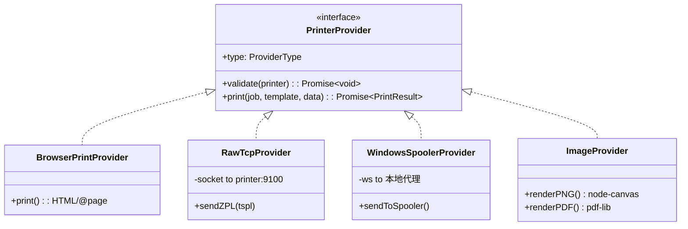
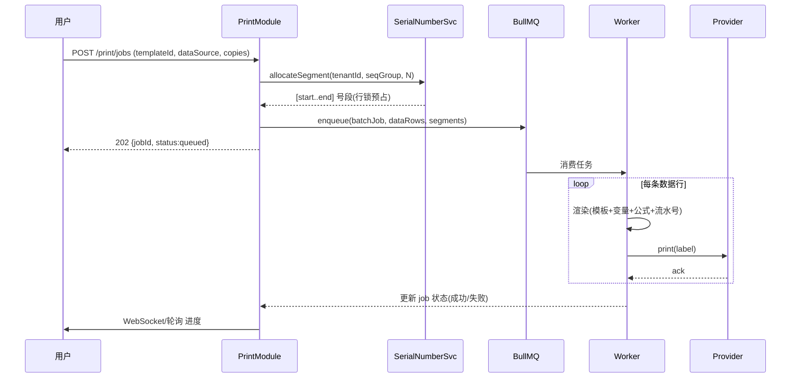

# 2. 系统架构设计

## 2.1 总体分层（文字描述）

```
┌─────────────────────────────────────────────────────────────────┐
│  浏览器（React + Konva 设计器 / 打印预览）                         │
│  - 拖拽式设计器、公式预览、条码实时渲染、@page 浏览器打印           │
└───────────────┬───────────────────────────────┬─────────────────┘
                │  HTTPS (REST + JWT)            │  WebSocket（可选：打印进度）
                ▼                                ▼
┌─────────────────────────────────────────────────────────────────┐
│  API 网关 / NestJS（BFF + 业务编排）                               │
│  ├─ AuthModule（JWT+Refresh, bcrypt）                             │
│  ├─ TenantGuard（注入 tenant_id，行级隔离，禁止前端决定数据范围）  │
│  ├─ TemplateModule（CRUD/版本/导入导出/缩略图）                   │
│  ├─ VariableModule / FormulaEngine（自研 AST）                    │
│  ├─ SerialNumberModule（行锁 + 号段预分配）                       │
│  ├─ BarcodeModule（checksum + 服务端出图 @bwip-js）               │
│  ├─ PrintModule（任务编排 + Provider 路由）                       │
│  ├─ DataSourceModule（CSV/Excel/SQL）                             │
│  └─ AuditModule（操作/打印日志）                                  │
└───────┬───────────────────────┬───────────────────┬───────────────┘
        │                        │                   │
        ▼                        ▼                   ▼
┌────────────┐          ┌──────────────┐   ┌──────────────────────┐
│ PostgreSQL │          │    Redis     │   │  BullMQ Worker 池     │
│ 16         │          │  7（号段/    │   │  ├ 批量渲染出图(PNG/   │
│ tenant_id  │          │  队列/缓存） │   │  │ PDF, node-canvas)    │
│ 行隔离      │          └──────────────┘   │  ├ ZPL/TSPL 生成       │
│ JSONB 模板  │                             │  └ 指令下发 Provider    │
└────────────┘                             └──────────┬───────────┘
                                                     │
                              ┌──────────────────────┼───────────────────┐
                              ▼                      ▼                   ▼
                        ┌───────────┐        ┌─────────────┐     ┌──────────────┐
                        │ RawTcp    │        │ 本地打印代理 │     │ ImageProvider│
                        │ 9100 直连 │        │ (Win Spooler│     │ 出图存档/    │
                        │ ZPL/TSPL  │        │  WebSocket) │     │ 第三方集成   │
                        └───────────┘        └─────────────┘     └──────────────┘
```

**关键点**
- 所有跨租户读写的 Repository 方法**强制第一参数 `tenantId`**，由 `TenantGuard` 从 JWT 解析后注入；Controller 不接收任何租户选择参数。
- 批量出图/指令生成全部进入 **BullMQ Worker**，主事件循环不阻塞，保证 1000 条批量打印异步处理。
- 指令生成（ZPL/TSPL）在 Provider 内按 `printer.dpi` 将 mm 换算为 dots。

## 2.2 架构图（Mermaid）

### 2.2.1 容器级（C4 Container）

```mermaid
flowchart TB
  User([用户/操作员]) -->|HTTPS+JWT| Web[React 设计器/预览]
  Web -->|REST| API[NestJS API]
  API --> PG[(PostgreSQL 16\ntenant_id 行隔离\nJSONB 模板)]
  API --> R[(Redis\n号段/队列/缓存)]
  API --> MQ[BullMQ Worker 池]
  MQ --> RawTcp[RawTcpProvider\n:9100]
  MQ --> Agent[本地打印代理\nWin Spooler]
  MQ --> Img[ImageProvider\nPNG/PDF]
  Web -->|@page 打印| Browser[浏览器打印]
  API --> Obj[(对象存储\n定时备份)]
  API --> Audit[(审计日志\nPG)]
```

### 2.2.2 打印通道抽象（Mermaid Class）



### 2.2.3 批量打印时序（Mermaid Sequence）



## 2.3 多租户隔离策略

1. **行级隔离**：每张业务表含 `tenant_id BIGINT NOT NULL`，建联合索引 `(tenant_id, ...)`；所有查询 WHERE 必带 `tenant_id`。
2. **网关注入**：`TenantGuard` 解析 JWT 的 `tenantId`，写入 `Request.tenantId` 与 AsyncLocalStorage；Repository 从此取值，前端传参无效。
3. **资源级 ACL**：模板表 `acl` JSONB 记录 `{userId: ['view','edit','print','export','share']}`，超管/所有者默认可全权；共享走独立 `template_shares` 表。
4. **越权校验**：任何按 `id` 取资源的接口，先 `WHERE id=? AND tenant_id=?`，命中为空即 404（不暴露存在性）。
