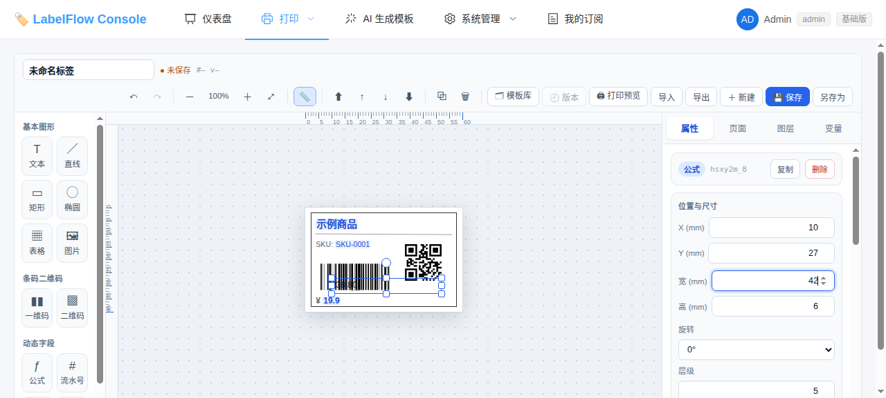
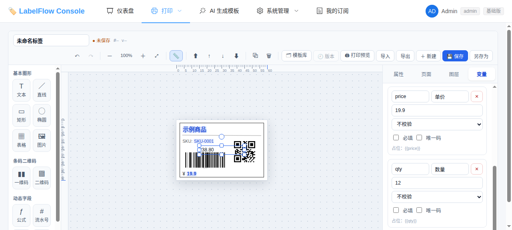

# 公式功能使用指南

标签设计器的「公式」元素，根据变量动态计算并显示文本。设计态预览与打印出纸使用相同函数表与语义，由一致性测试锁定，所见即所得。

## 一、添加公式元素

打开 /designer，在左侧「动态字段」工具箱点击 **ƒ 公式**，画布出现元素。选中后右侧属性面板显示「公式」输入框和函数提示。

上例输入 `FORMAT({{price}} * {{qty}}, "0.00")`，画布即时显示 `238.80`（price=19.9、qty=12）。

## 二、引用变量

公式用 `{{变量名}}` 引用数据。变量名来自「变量」面板。

- `{{price}}` — 模板变量，设计态用示例值预览
- `{{@pageNo}}`、`{{@pageTotal}}` — 页码系统变量
- `{{@printDate}}` — 打印日期，可带格式与偏移，如 `{{@printDate:YYYYMMDD|+3d}}`

一处计算、多处引用？给变量填「计算公式」即可，见第七节。

## 三、语法

| 类别 | 写法 |
| --- | --- |
| 算术 | `+` `-` `*` `/` `%`，括号 `()` |
| 比较 | `>` `<` `>=` `<=` `==` `!=` |
| 逻辑 | `&&` `\|\|` `!` |
| 字面量 | 数字 `12.5`；字符串 `'A'` 或 `"A"` |
| 常量 | `TRUE` `FALSE` |

运算符优先级：`()` > `!` > `* / %` > `+ -` > 比较 > `&&` > `||`。

## 四、函数速查

共 30 个，按类别列出。函数名大小写不敏感。

**文本类**

| 函数 | 说明 | 示例 |
| --- | --- | --- |
| `LEN(s)` | 字符长度 | `LEN("ABC")` → 3 |
| `UPPER(s)` / `LOWER(s)` | 大小写转换 | `UPPER("ab")` → AB |
| `TRIM(s)` | 去首尾空格 | |
| `LEFT(s,n)` / `RIGHT(s,n)` | 左/右取 n 位 | `LEFT("ABC",2)` → AB |
| `MID(s,start,len)` | 从 1 开始取 len 位 | `MID("ABC123",3,3)` → C12 |
| `REPLACE(s,a,b)` | 把 a 全部替换为 b | `REPLACE("a-b","-","_")` → a_b |
| `CONCAT(...)` | 拼接任意多个值 | `CONCAT("A",1)` → A1 |

**数值类**

| 函数 | 说明 |
| --- | --- |
| `ROUND(n,d)` | 四舍五入到 d 位 |
| `FLOOR(n)` / `CEIL(n)` | 向下 / 向上取整 |
| `ABS(n)` | 绝对值 |
| `INT(n)` | 截断取整（直接去掉小数） |
| `NUM(s)` | 从字符串提取数字 |
| `FORMAT(n,fmt)` | 格式化：`"0.00"` 保留两位、`"000"` 补零 |
| `PAD(n,w)` | 数字左侧补零到 w 位 |
| `PADLEFT(s,n,ch)` / `PADRIGHT(s,n,ch)` | 字符串左右补字符 |

**逻辑类**

| 函数 | 说明 |
| --- | --- |
| `IF(c,a,b)` | 条件成立取 a，否则取 b |
| `AND(...)` / `OR(...)` / `NOT(c)` | 与 / 或 / 非 |
| `ISEMPTY(v)` | 是否为空 |

**日期类**

| 函数 | 说明 |
| --- | --- |
| `NOW()` / `TODAY()` | 当前时间 / 今天 0 点 |
| `DATE(y,m,d)` | 构造日期（m 从 1 开始） |
| `DATEDIFF(a,b,unit)` | 日期差，unit 取 `day`/`hour`/`minute` |
| `DATEFORMAT(d,fmt)` | 日期格式化，如 `YYYY-MM-DD` |

**校验位类**

| 函数 | 说明 |
| --- | --- |
| `CHECKSUM(scheme,data)` | 条码校验位。scheme 取 `EAN13`/`EAN8`/`UPCA`/`ITF14`/`GTIN`/`MOD10`、`CODE39`/`MOD43`、`CODE128`/`MOD103` |

## 五、常见示例

- 金额两位小数：`FORMAT({{price}} * {{qty}}, "0.00")`
- 按数量分流：`IF({{qty}} > 10, "批发", "零售")`
- 拼接补零编号：`CONCAT({{sku}}, "-", PAD({{qty}}, 3))`
- EAN13 校验位：`CHECKSUM("EAN13", "690123456789")`
- 距今天数：`DATEDIFF(TODAY(), DATE(2026,1,1), "day")`

## 六、出错处理

- 设计态：求值失败时属性面板显示红色提示，画布显示 `#公式错误`。
- 打印态：失败元素显示 `{{ERROR}}`，不会中断整张打印单。
- 常见错误：未定义变量、未知函数、括号不匹配、除零。

## 七、计算变量（把公式结果当变量用）

在「变量」面板给变量填写「计算公式」，它就成为计算变量：按数据行实时求值，结果可直接用 `{{变量名}}` 在文本、条码、其他公式里引用——一处计算、多处复用。

例：定义 `price`、`qty` 后新增变量 `amount`，公式填 `{{price}} * {{qty}}`。此后写 `{{amount}}` 即得金额，无需在每个公式元素里重复乘式。

- 计算变量可引用其它计算变量（如 `discount` = `{{amount}} * 0.9`），系统按依赖顺序求值；打印时每行重算。
- 有公式时「示例值」变为出错兜底值：求值失败或依赖成环时显示该值，不阻断整单。
- 变量面板实时提示循环依赖（如 `a = {{b}}+1`、`b = {{a}}+1`），环上变量回落到兜底值。
- 普通变量（不填公式）行为不变。

## 八、前后端一致性

设计态引擎在 `apps/console/src/views/designer/engine/context.ts`，打印引擎在 `backend/core/formula-engine.ts`，计算变量求值分别在 `context.ts#resolveComputedVars` 与 `backend/core/computed-vars.ts`。两端的函数表、求值语义与计算变量结果由 `backend/core/__tests__/formula-parity.test.ts` 用 37 条表达式及计算变量用例逐条比对锁定。新增或修改函数、改动计算变量求值时，必须同时更新两端并让该测试通过，否则会出现「预览对、打印错」。
