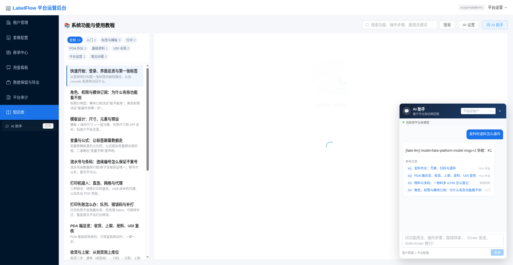
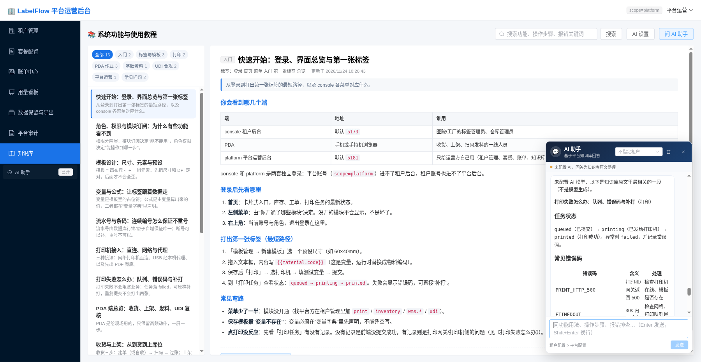
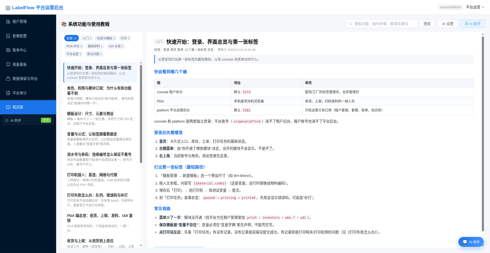
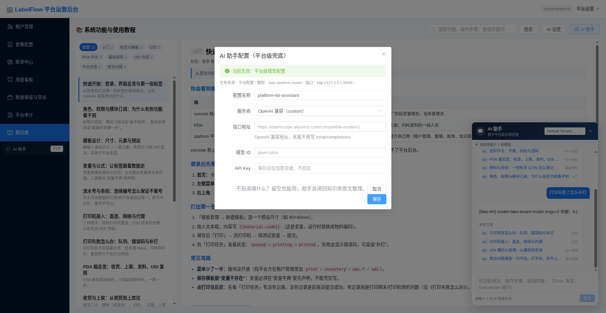

# 平台端知识库 + AI 助手（D6）

> 一句话：平台运营后台多了「知识库」页（16 篇系统功能与使用教程）和右下角的 AI 助手悬浮球。
> 助手回答**只用知识库内容**，模型配置按「租户 → 平台 → 环境变量 → 无」四级回退；四级都没有时降级为"知识库原文整理"，照样能答。

## 1. 为什么要做

交付到 D5 之后，客户侧反馈最集中的不是"功能不够"，而是"不知道怎么用"：

- 同一个问题（"菜单少了一半""打印点了没反应"）在支持渠道里反复出现；
- 运营/实施新人接手时要翻 5 份 docs 才能回答"发料能不能退料"；
- 客户开会问"你们 UDI 能上报国家平台吗"，答复口径散落在 `docs/29` 的能力清单里。

所以把「系统功能 + 使用教程」沉成**平台端可读的知识库**，再加一个**能按知识库回答问题的助手**。
注意：这一版的知识库是**平台运营侧**的，不是给租户终端用户看的 —— 租户端（console/PDA）没有这个入口，后端也拦着。

## 2. 知识库内容

16 篇，7+1 个分类（`kb_articles`，无 `tenant_id` —— 平台级公共内容）：

| 分类 | 篇目 | 覆盖 |
| --- | --- | --- |
| 入门 | `quick-start`、`role-and-modules` | 三个端各是什么、登录后先看哪里、为什么有些菜单看不到 |
| 标签与模板 | `template-basics`、`template-variables`、`serial-and-barcode` | 尺寸/DPI、元素、变量与公式、流水号与校验位 |
| 打印 | `printer-setup`、`print-queue` | 网络/USB 代理/PDF 兜底三种接法；失败、错误码、补打 |
| PDA 作业 | `pda-overview`、`wms-inbound`、`wms-issuing` | 收货三步、上架、齐套 → 发料 → 过账 → 退料 |
| 基础资料 | `master-data` | 物料、一物料多 GTIN、库位、BOM |
| UDI 合规 | `udi-basics`、`udi-export` | DI+PI、单品/箱码、导出 14 字段、合规边界 |
| 平台运营 | `platform-ops` | 租户生命周期、套餐、用量、审计、数据保留 |
| 常见问题 | `faq-troubleshooting`、`ai-assistant` | 扫不出/打不出/对不上怎么查；助手自己能做什么 |

写入方式：`backend/scripts/kb_seed_articles.sql`（`ON CONFLICT (slug) DO UPDATE`，幂等，改内容重跑即可）。
DDL 在 `backend/scripts/kb_p1_articles.sql`，两个脚本都已登记进 `db-manifest.txt`，`db-init.sh` 会自动执行。

## 3. 后端接口（`/api/v1/kb`）

控制器：`backend/src/kb/kb.controller.ts`，类上 `@Public()`（跳过租户守卫链）+ `@UseGuards(PlatformJwtGuard)`：

| 方法 | 路径 | 说明 |
| --- | --- | --- |
| GET | `/kb/articles` | 列表，支持 `category` / `keyword` / `limit`；不带全文 |
| GET | `/kb/categories` | 分类 + 每类篇数（左侧目录） |
| GET | `/kb/articles/:slug` | 单篇全文 |
| GET | `/kb/search?q=` | 纯检索（给搜索框；助手内部走同一打分函数） |
| POST | `/kb/assistant/ask` | 问答，`{question, tenantId?, limit?}` |
| GET | `/kb/assistant/status?tenantId=` | 当前生效来源（不回显 key） |
| POST | `/kb/assistant/config` | 保存**平台级**配置（写 `ai_model_configs` 的 `tenant_id=0`，key AES-256-GCM 加密） |

守卫的效果是"知识库只在平台端"：平台 token（`scope=platform`）能进，租户 token 打进来是 401（`缺少平台 token`），
不带 token 也是 401。这一点在真库上用 curl 验过（见 §6）。

检索打分（`kb.calc.ts`，纯函数，13 例单测）：
中文按 2 字滑窗切词 + 英文按词；标题命中 6 分、标签 3 分、摘要 2 分、正文最多 3 分封顶；
`score >= 6` 才算"有把握"，否则助手会明说没找到并给提问建议。

## 4. 配置优先级（用户明确要求的顺序）

```
租户自己的默认模型配置（tenant → ai_model_configs.is_default）
  ↓ 没有
平台级配置（tenant_id = 0）
  ↓ 没有
环境变量（AI_KB_BASE_URL / AI_KB_API_KEY / AI_KB_MODEL）
  ↓ 没有
none → 助手降级为"知识库原文整理"（明确标注"不是模型生成"）
```

- `resolveAiConfig()` 只认 **endpoint + key + model 三者齐全** 的记录，缺一个就当没配（避免配一半报错）。
- 问答返回里带 `aiSource`（`tenant` / `platform` / `env` / `none`）和 `note`，前端据此显示"当前用平台级模型 / 未配置 AI"。
- 模型调用失败（超时、401、网络断）**不会让用户看不到答案**：落 `answeredBy='llm_failed'`，退回知识库原文整理，并在 `note` 里写明失败原因（详情写进 `kb_assistant_logs.detail`）。
- 兼容两种协议：OpenAI 的 `/chat/completions`，以及 ollama 的 `:11434` / `/api/chat`；30 秒超时。

## 5. 前端（`apps/platform`）

**知识库页** `src/views/Knowledge.vue`（路由 `/knowledge`，菜单「知识库」）：

- 左侧分类胶囊（带篇数）+ 文章列表（标题 + 摘要），右侧正文；
- 正文是我们自己种进库的 Markdown，`src/utils/md.ts` 做**极简渲染**（先整体 HTML 转义再替换标记，`v-html` 不会放行可执行标签）；
  平台端没有 markdown-it / marked 依赖，所以标题、表格、列表、引用、行内 code、加粗都是自己实现的；
- 右侧底部有「这篇没讲清楚？问 AI 助手」按钮；顶部有「AI 设置」弹窗（配平台级兜底模型）。

**AI 助手** `src/components/AiAssistant.vue`（挂在 `PlatformLayout` 里，全站可用）：

- 右下角悬浮：面板 400×580，`z-index 2000`；
- header 有租户上下文下拉（选某个租户 → 问答按该租户的 AI 配置优先）、清空对话、**关闭 ×**；
- 关闭后只剩右下角「💬 AI 助手」胶囊球；**侧栏菜单底部还有常驻的「AI 助手」入口**（`PLATFORM_MENUS` 里带 `action:'assistant'` 的那项，不占路由），点一下就能调回来；
- 开/关状态写 `localStorage['labelflow_platform_ai_open']`，刷新后保持；聊天记录存 `labelflow_platform_ai_chat`（最近 20 条，不带 loading 态）；
- 每条回答下面列「参考文章」K1/K2…，点一下跳到知识库对应章节（`/knowledge?slug=…`，跳转后自动收起面板）；
- 长答案来了之后滚动到**这条回答的开头**，不是滚到底 —— 知识库原文动辄十几行，滚到底只能看到结尾。

## 6. 验收记录（真库实跑）

环境：vm 上重建的 PG14 + Redis，`labelflow_test` 库，服务 3202 端口，平台账号 `platform`。

| # | 验证 | 结果 |
| --- | --- | --- |
| 1 | `db-init.sh` 34 脚本 / 79 表自检 | PASS（新增 `kb_articles`、`kb_assistant_logs` 后仍 79 张全部命中）|
| 2 | 未带 token 调 `/kb/articles` | 401 `缺少平台 token` |
| 3 | 带平台 token 调列表 / 分类 / 详情 / 搜索 | 200；16 篇、8 个分类计数正确 |
| 4 | 未配模型时提问（"发料退料怎么操作"） | `answeredBy=kb`、`aiSource=none`，返回原文整理 + 4 篇引用 |
| 5 | 只配平台级模型（指向本地假 LLM） | `aiSource=platform`、`answeredBy=llm`，模型回包正常 |
| 6 | 再加租户 1 自己的配置 | `aiSource=tenant`，同一问题改走租户模型（**优先级生效**）|
| 7 | 把租户 endpoint 改坏 | `answeredBy=llm_failed` + note，答案仍返回（**失败降级生效**）|
| 8 | 浏览器实测：知识库页/分类切换/搜索"GTIN"/正文表格渲染 | 正常（`docs/images` 之外，截图见交付说明）|
| 9 | 浏览器实测：关闭助手 → 悬浮球 → 侧栏「AI 助手」再调出 | 正常，侧栏标签在「打开/已开」之间切换 |
| 10 | 浏览器实测：选租户 1 后提问 | 状态变"当前用租户 1 的模型"，回答走租户模型 |
| 11 | `kb.calc` 单测 | 13 例全绿 |

> 测试期写进库的两条假配置（`platform-kb-assistant` / `tenant-kb-assistant`，指向 `127.0.0.1:8099`）**已删干净**，`ai_model_configs` 现为 0 行 —— 也就是当前默认状态是"未配置 AI，只答知识库原文"。

## 7. 诚实边界（这一版不做的）

1. **不会自己长知识**：没有向量库、没有 embedding，就是中文 2 字切词 + 字段加权。问法跟文章用词差太远会搜不到（这时助手会说没找到 + 给改写建议），不会硬编。
2. **不写租户端**：console / PDA 没有知识库入口，也没有"问 AI"按钮。要给终端用户看，得另做一套（并且要想清楚哪些内容能对外）。
3. **不做富文本后台**：文章靠 SQL 种，平台端没有"新建/编辑文章"的界面。改内容 = 改 `kb_seed_articles.sql` 后重跑（幂等）。
4. **不代理业务操作**：助手只答"怎么用"，不会替用户点按钮、改配置、查租户业务数据。
5. **没有流式输出**：等模型整段返回（最长 30 秒），期间显示打字动画。
6. **不做会话记忆**：每次提问独立检索，不带上下文追问（"那第二步呢"这种会搜不到）。
7. **合规口径**：UDI 相关回答只到"可映射的台账导出"，不承诺官方平台报文上报。

## 7.1 界面实拍

知识库页（左分类 + 中列表 + 右正文，表格/列表/行内 code 都按原样式渲染）：



助手回答（未配置模型时的降级形态：原文摘 + 参考文章 K1…）：



关闭后只剩右下角悬浮球，侧栏「AI 助手」入口随时再调出：



平台级 AI 配置弹窗（写 `ai_model_configs` 的 `tenant_id=0`）：



## 8. 运维要点

- 新增/修改文章：改 `backend/scripts/kb_seed_articles.sql` → 在目标库执行该脚本（`ON CONFLICT` 幂等，不会重复插入）。
- 配平台级模型：平台后台「知识库 → AI 设置」填 endpoint / model / key；key 落库前 AES-256-GCM 加密（`SQL_SECRET_KEY` 建议生产必配，否则用内置 dev key）。
- 配租户级模型：走租户自己的 AI 配置（`ai_model_configs.tenant_id = <租户>` + `is_default`），平台这边不用改；助手按租户上下文自动优先用它。
- 想彻底关掉助手：前端把「AI 助手」菜单项去掉即可；后端接口留着不影响任何租户业务。
- 日志：每次问答写 `kb_assistant_logs`（question / tenant_id / hits / answered_by / model / duration_ms / detail），排查"为什么这么答"就看这张表。
